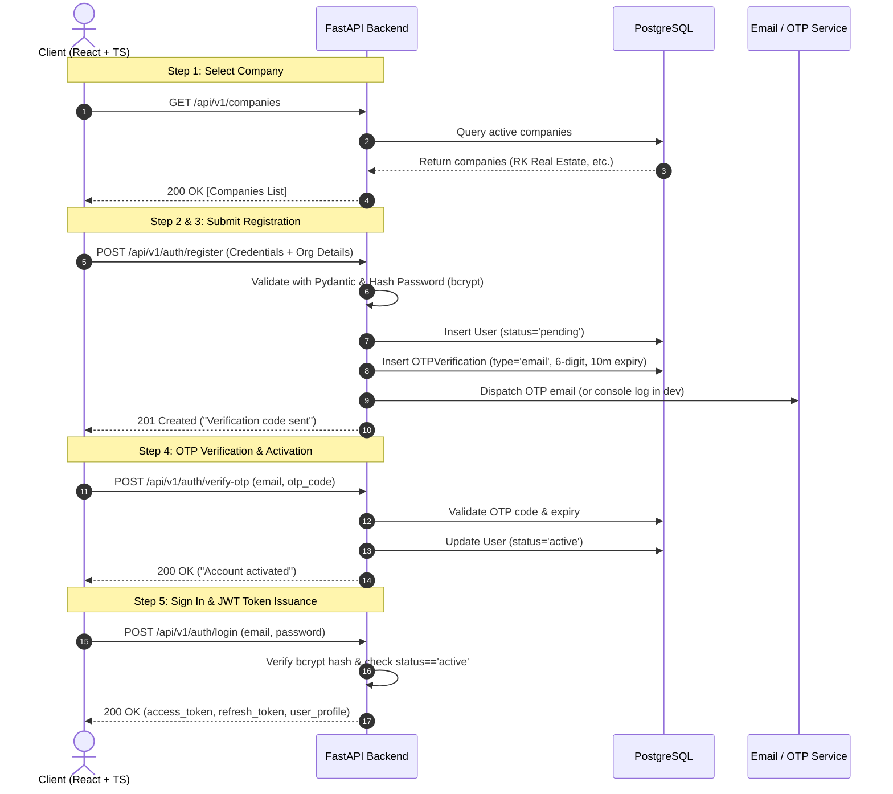

# SCuilONE — Multi-Industry Multi-Tenant CRM Platform

> **"One Platform, Every Industry, Complete CRM Solution."**

SCuilONE is a SaaS CRM platform engineered around a high-reuse CRM core and configurable, metadata-driven industry vertical packs.

---

## 🚀 System Architecture & Authentication Flow

Based on the official implementation baseline and system design specifications, user onboarding operates on a secure 5-step registration and activation lifecycle:



---

## 👥 3-Member Team Division of Work & Git Workflow

| Member | Role | Core Deliverables | Branch Prefix |
| :--- | :--- | :--- | :--- |
| **Member 1 (You)** | **Backend Core & Auth Lead** | Multi-tenant DB, JWT Auth, Registration & OTP endpoints, MFA, Docker Compose, CI/CD | `feat/m1-auth-*` |
| **Member 2** | **CRM Domain & Metadata Specialist** | Leads, Contacts, Accounts, Deals/Pipelines, Custom Fields & Industry Templates | `feat/m2-crm-*` |
| **Member 3** | **Frontend Lead & UX Engineer** | React + TypeScript UI Shell, Kanban Pipeline, Dynamic Forms, Registration/Login views | `feat/m3-frontend-*` |

### Git Branching Guidelines
1. **`main`**: Production-ready branch. Protected.
2. **`develop`**: Central integration branch. All feature branches merge here via Pull Request (PR).
3. **Feature branches**: Always branch off `develop` (e.g. `git checkout -b feat/m1-auth-endpoints develop`).
4. **Before merging**: Ensure all automated tests pass (`pytest -v`).

---

## 🛠️ Quickstart Guide

### Option A: Local Development (Fastest)

1. **Navigate to the backend directory**:
   ```bash
   cd backend
   ```

2. **Activate the virtual environment**:
   - **Windows PowerShell**:
     ```powershell
     .\.venv\Scripts\Activate.ps1
     ```
   - **macOS / Linux**:
     ```bash
     source .venv/bin/activate
     ```

3. **Install dependencies** (if not already installed):
   ```bash
   pip install -r requirements.txt
   ```

4. **Run the FastAPI server**:
   ```bash
   python run.py
   ```
   *The server starts at `http://localhost:8000` with auto-reload.*

5. **Access Interactive API Docs (Swagger UI)**:
   Open your browser to: **[http://localhost:8000/docs](http://localhost:8000/docs)**

6. **Run the Automated Test Suite**:
   ```bash
   pytest -v
   ```

---

### Option B: Docker Compose (Full Stack with PostgreSQL & Redis)

From the project root:
```bash
docker compose up --build
```

---

## 🔑 Pre-Seeded Accounts & Demo Data

On startup, the system automatically provisions initial companies, roles, and test credentials:

### Seeded Companies (Step 1 Selection)
*   **RK Real Estate** (`realestate.scuilone.com`)
*   **EduGlobal** (`education.scuilone.com`)
*   **TechSolutions** (`software.scuilone.com`)
*   **SafeLife Insurance** (`insurance.scuilone.com`)
*   **AutoDrive Motors** (`automobile.scuilone.com`)

### Pre-Configured Test Accounts
*   **Platform Super Admin**:
    *   **Email**: `admin@scuilone.com`
    *   **Password**: `Admin@123456`
    *   **Role**: Platform Super Admin
*   **Tenant Admin (RK Real Estate)**:
    *   **Email**: `admin@rkrealestate.com`
    *   **Password**: `Tenant@123456`
    *   **Role**: Tenant Admin

---

## 📡 API Reference Summary

| Method | Endpoint | Description |
| :--- | :--- | :--- |
| `GET` | `/api/v1/companies` | List all active companies (for Step 1 registration dropdown) |
| `POST` | `/api/v1/auth/check-email` | Verify if an email is available or registered |
| `POST` | `/api/v1/auth/register` | Register new user under a company (initiates 6-digit OTP) |
| `POST` | `/api/v1/auth/verify-otp` | Verify 6-digit OTP and activate account |
| `POST` | `/api/v1/auth/resend-otp` | Re-send fresh OTP code to user's email |
| `POST` | `/api/v1/auth/login` | Authenticate with email/password (returns JWT or MFA challenge) |
| `POST` | `/api/v1/auth/verify-mfa` | Verify 6-digit MFA OTP code during login |
| `POST` | `/api/v1/auth/forgot-password` | Send password reset OTP |
| `POST` | `/api/v1/auth/reset-password` | Reset password using verified OTP |
| `GET` | `/api/v1/auth/me` | Fetch authenticated user profile & tenant info (Requires Bearer token) |
